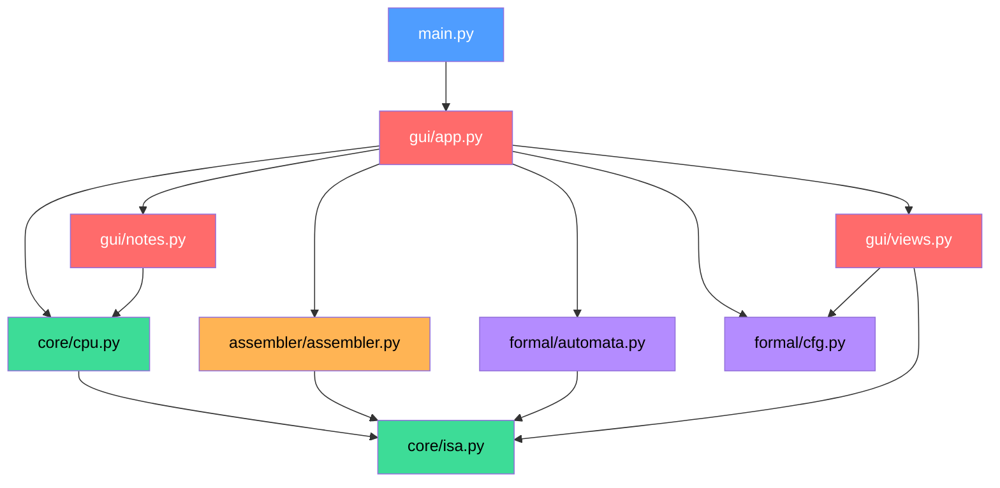
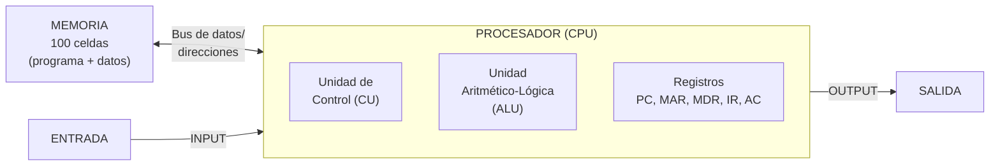
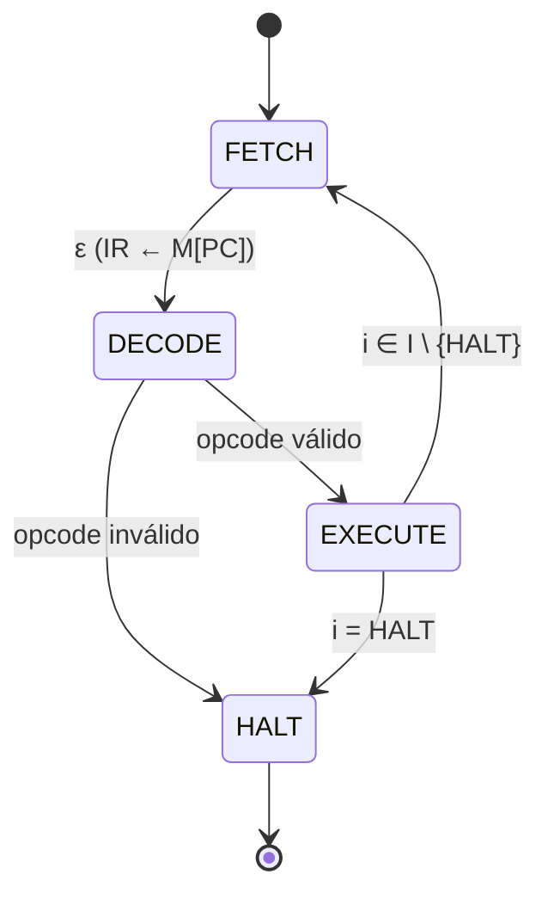
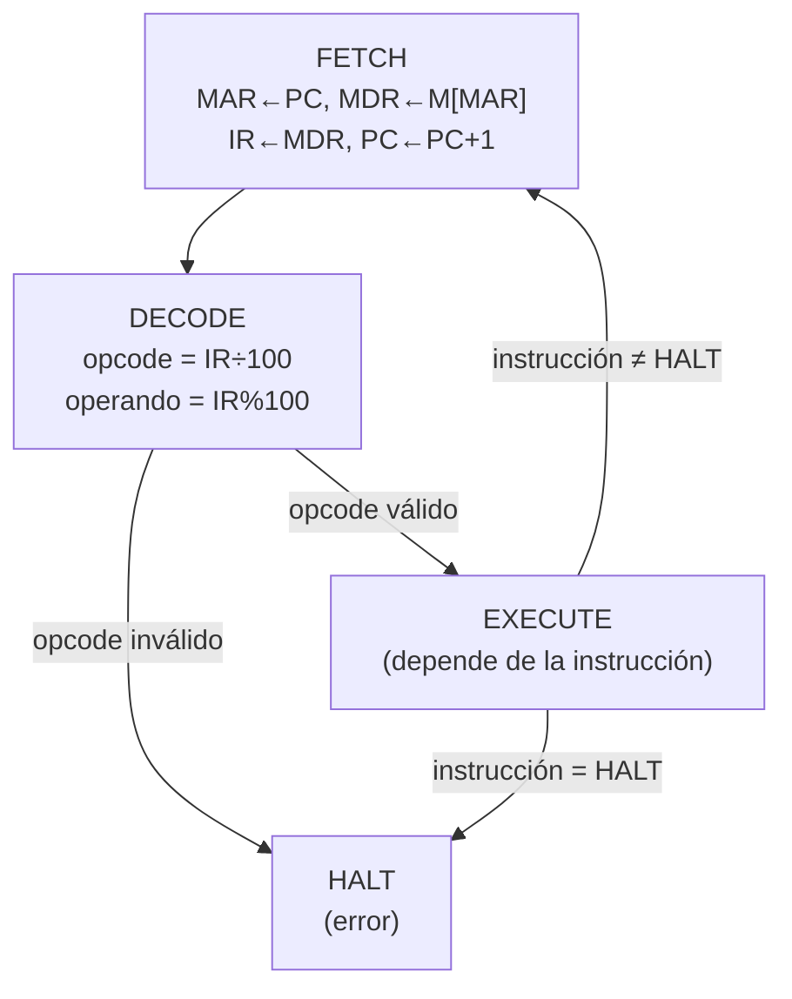
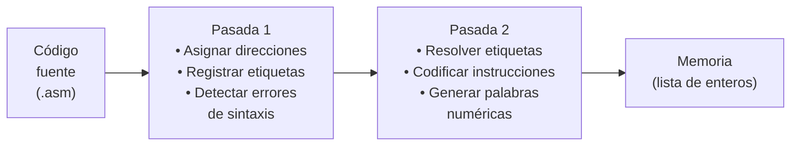

# 🖥️ Emulador Von Neumann

**Simulador interactivo de un computador basado en la arquitectura Von Neumann**, con interfaz gráfica, ensamblador de dos pasadas, modelo formal de autómata finito, álgebra booleana y grafo de flujo de control.

Desarrollado como proyecto integrador de **Arquitectura de Computadores** y **Matemáticas Discretas**.

---

## 📑 Tabla de Contenidos

1. [Requisitos](#-requisitos)
2. [Instalación y ejecución](#-instalación-y-ejecución)
3. [Arquitectura del proyecto](#-arquitectura-del-proyecto)
4. [El Modelo Von Neumann](#-el-modelo-von-neumann)
5. [Conjunto de instrucciones (ISA)](#-conjunto-de-instrucciones-isa)
6. [Ciclo de instrucción](#-ciclo-de-instrucción)
7. [El Ensamblador](#-el-ensamblador)
8. [Modelo Formal](#-modelo-formal)
9. [Interfaz gráfica](#-interfaz-gráfica)
10. [Programas de ejemplo](#-programas-de-ejemplo)
11. [Pruebas](#-pruebas)
12. [Correspondencia con Matemáticas Discretas](#-correspondencia-con-matemáticas-discretas)
13. [Glosario](#-glosario)

---

## 📋 Requisitos

| Requisito | Versión mínima |
|-----------|---------------|
| Python | 3.10+ |
| customtkinter | ≥ 5.2 |

El proyecto utiliza **customtkinter** para la interfaz gráfica moderna con tema oscuro. Internamente depende de `tkinter` (incluido con la instalación estándar de Python en Windows y macOS; en Linux puede requerir `sudo apt install python3-tk`).

---

## 🚀 Instalación y ejecución

### 1. Clonar o descargar el proyecto

```bash
git clone <url-del-repositorio>
cd emulador
```

### 2. Crear un entorno virtual (recomendado)

```bash
python -m venv venv
# Windows:
venv\Scripts\activate
# Linux/macOS:
source venv/bin/activate
```

### 3. Instalar dependencias

```bash
pip install -r requirements.txt
```

### 4. Ejecutar el emulador

```bash
python main.py
```

### 5. Ejecutar las pruebas

```bash
python -m pytest tests/
# o bien:
python -m unittest discover -s tests
```

---

## 🏗️ Arquitectura del proyecto

```
emulador/
├── main.py                  # Punto de entrada
├── requirements.txt         # Dependencias (customtkinter>=5.2)
├── core/
│   ├── isa.py              # Definición del ISA: 13 instrucciones, codificación, decodificación
│   └── cpu.py              # CPU: registros, ciclo fetch-decode-execute, máquina de estados
├── assembler/
│   └── assembler.py        # Ensamblador de dos pasadas
├── formal/
│   ├── automata.py         # Autómata finito M = (Q, Σ, δ, q0, F), tablas de verdad
│   └── cfg.py              # Grafo de flujo de control G = (V, E) y análisis
├── gui/
│   ├── app.py              # Ventana principal, controlador de la simulación
│   ├── views.py            # Vistas Canvas: arquitectura, memoria, autómata, CFG
│   └── notes.py            # Explicaciones didácticas en vivo
├── programas/               # Programas de ejemplo en ensamblador (.asm)
└── tests/                   # Pruebas unitarias y de humo de la GUI
```

### Diagrama de dependencias entre módulos



### Descripción de cada módulo

#### `core/isa.py` — Conjunto de instrucciones

Define las 13 instrucciones del computador, sus opcodes, la codificación/decodificación de palabras de memoria y el manejo de desbordamiento de 16 bits con signo.

- **`MEM_SIZE = 100`**: la memoria tiene 100 celdas (direcciones 0–99).
- **`WORD_MIN, WORD_MAX = -32768, 32767`**: rango de entero de 16 bits con signo.
- **`encode(mnemonic, operand)`**: codifica una instrucción como `opcode × 100 + operando`.
- **`decode(word)`**: descompone una palabra en `(opcode, operando)` usando `divmod(word, 100)`.
- **`wrap(value)`**: ajusta un entero al rango de 16 bits (desbordamiento aritmético).

#### `core/cpu.py` — Procesador

Implementa el procesador como una **máquina de estados** con fases `{FETCH, DECODE, EXECUTE, HALT}`. Cada llamada a `step_phase()` aplica **una transición** y devuelve los eventos (micro-operaciones) que ocurrieron.

Registros:
- **PC** (Program Counter): dirección de la próxima instrucción.
- **MAR** (Memory Address Register): dirección a leer/escribir.
- **MDR** (Memory Data Register): dato leído/escrito de/en memoria.
- **IR** (Instruction Register): instrucción actual.
- **AC** (Accumulator): resultado de operaciones y origen de las banderas Z y N.

Métodos principales:
- `step_phase()`: avanza una fase del ciclo.
- `step_instruction()`: ejecuta un ciclo completo (FETCH → DECODE → EXECUTE).
- `run(max_steps)`: ejecuta hasta HALT, entrada o límite de pasos.

#### `assembler/assembler.py` — Ensamblador de dos pasadas

Traduce código fuente en ensamblador a palabras numéricas en memoria:
- **Pasada 1**: identifica etiquetas y sus direcciones, detecta errores de sintaxis.
- **Pasada 2**: resuelve referencias a etiquetas y genera las palabras codificadas.

#### `formal/automata.py` — Autómata finito

Modela formalmente el procesador como `M = (Q, Σ, δ, q0, F)`. Incluye la función de transición `delta()`, generación de formato Graphviz DOT y tablas de verdad para las operaciones lógicas y saltos condicionales.

#### `formal/cfg.py` — Grafo de flujo de control

Construye el grafo dirigido `G = (V, E)` de un programa ensamblado. Analiza propiedades como alcanzabilidad, caminos a HALT y detección de ciclos usando BFS y DFS.

#### `gui/app.py` — Ventana principal

Controlador central: orquesta la CPU, el ensamblador, los modelos formales y las cuatro pestañas de la interfaz. Maneja atajos de teclado, velocidad de simulación y entrada/salida.

#### `gui/views.py` — Vistas Canvas

Cuatro vistas renderizadas con `tkinter.Canvas`:
1. **ArchView**: diagrama animado de la arquitectura (registros, ALU, memoria, buses).
2. **MemView**: cuadrícula 10×10 que muestra las 100 celdas de memoria con códigos de color.
3. **AutomatonView**: visualización del autómata finito con estados y transiciones.
4. **CFGView**: grafo de flujo de control del programa con cobertura de ejecución.

#### `gui/notes.py` — Notas didácticas

Textos explicativos que se muestran al hacer clic en componentes, después de cada fase, y en la pestaña «Notas para exponer». Incluye una guía completa de exposición con preguntas y respuestas frecuentes.

---

## 🧠 El Modelo Von Neumann

Este emulador implementa los principios fundamentales de la **arquitectura Von Neumann** (1945):



### Características clave implementadas

| Principio Von Neumann | Implementación en el emulador |
|------------------------|-------------------------------|
| Programa almacenado en memoria | Instrucciones y datos comparten las mismas 100 celdas (`cpu.mem`) |
| Ejecución secuencial | El PC se incrementa en 1 tras cada FETCH |
| Instrucciones como datos | Un programa puede modificar sus propias instrucciones (verificado en pruebas) |
| Codificación numérica | `palabra = opcode × 100 + operando` (ej.: `305 = ADD 05`) |
| Palabra de tamaño fijo | Enteros de 16 bits con signo: −32768 a 32767 |
| Ciclo repetitivo | FETCH → DECODE → EXECUTE → FETCH → ... hasta HALT |

> **Nota:** La diferencia con la **arquitectura Harvard** es que Harvard usa memorias separadas para instrucciones y datos (y buses distintos), lo que permite leer ambas a la vez. Von Neumann usa una sola memoria, más simple pero con el «cuello de botella de Von Neumann»: instrucciones y datos compiten por el mismo bus.

---

## 📐 Conjunto de instrucciones (ISA)

El computador tiene un conjunto de 13 instrucciones definido formalmente como:

**I = {HALT, LOAD, STORE, ADD, SUB, JUMP, JZ, JN, INPUT, OUTPUT, AND, OR, NOT}**

**M = {0, 1, …, 99}**

Cada instrucción con operando es un elemento del producto cartesiano **I × M**.

### Tabla completa de instrucciones

| Opcode | Mnemónico | Operando | Descripción | Ejemplo |
|:------:|:---------:|:--------:|-------------|---------|
| 0 | `HALT` | — | Detiene el procesador | `HALT` → `000` |
| 1 | `LOAD` | dirección | AC ← M[x] | `LOAD 05` → `105` |
| 2 | `STORE` | dirección | M[x] ← AC | `STORE 10` → `210` |
| 3 | `ADD` | dirección | AC ← AC + M[x] | `ADD 05` → `305` |
| 4 | `SUB` | dirección | AC ← AC − M[x] | `SUB 03` → `403` |
| 5 | `JUMP` | dirección | PC ← x (salto incondicional) | `JUMP 00` → `500` |
| 6 | `JZ` | dirección | Si AC = 0, entonces PC ← x | `JZ 08` → `608` |
| 7 | `JN` | dirección | Si AC < 0, entonces PC ← x | `JN 12` → `712` |
| 8 | `INPUT` | — | AC ← valor del usuario | `INPUT` → `800` |
| 9 | `OUTPUT` | — | Muestra AC en consola | `OUTPUT` → `900` |
| 10 | `AND` | dirección | AC ← AC AND M[x] (bit a bit) | `AND 15` → `1015` |
| 11 | `OR` | dirección | AC ← AC OR M[x] (bit a bit) | `OR 15` → `1115` |
| 12 | `NOT` | — | AC ← NOT AC (bit a bit) | `NOT` → `1200` |

> **Importante:** Las instrucciones `HALT`, `INPUT`, `OUTPUT` y `NOT` **no llevan operando**. Las demás requieren una dirección de memoria (0–99) o una etiqueta que se resuelve a una dirección.

### Codificación de instrucciones

Cada palabra de memoria es un entero que codifica la instrucción así:

```
palabra = opcode × 100 + operando
```

Por ejemplo:
- `305` → opcode = 3 (`ADD`), operando = 5 → `ADD 05` (sumar el contenido de la celda 5 al acumulador)
- `608` → opcode = 6 (`JZ`), operando = 8 → `JZ 08` (saltar a la dirección 8 si AC = 0)

La decodificación se realiza con:
```python
opcode, operando = divmod(word, 100)
```

---

## 🔄 Ciclo de instrucción

El procesador repite sin cesar tres fases hasta llegar a `HALT`:



### Fase 1: FETCH (Búsqueda)

Trae la instrucción de memoria al procesador:

```
1. MAR ← PC          // Dirección de la siguiente instrucción
2. MDR ← M[MAR]      // Leer la palabra de esa celda
3. IR  ← MDR         // Copiarla al registro de instrucción
4. PC  ← PC + 1      // Avanzar el contador de programa
```

En código (`cpu.py`):
```python
def _fetch(self):
    self.mar = self.pc
    self.mdr = self.mem[self.mar]
    self.ir = self.mdr
    self.pc = (self.pc + 1) % self.size
    self.phase = "DECODE"
```

### Fase 2: DECODE (Decodificación)

La unidad de control separa la instrucción en opcode y operando:

```
opcode   = IR // 100
operando = IR % 100
```

Si el opcode no es válido (no corresponde a ninguna instrucción), el procesador pasa a `HALT` con un error.

### Fase 3: EXECUTE (Ejecución)

Se ejecuta la operación indicada por el opcode. El comportamiento depende del tipo de instrucción:

| Tipo | Instrucciones | Flujo de datos |
|------|---------------|----------------|
| Lectura de memoria | `LOAD`, `ADD`, `SUB`, `AND`, `OR` | MAR ← operando → MDR ← M[MAR] → ALU/AC |
| Escritura en memoria | `STORE` | MAR ← operando → MDR ← AC → M[MAR] ← MDR |
| Salto | `JUMP`, `JZ`, `JN` | PC ← operando (condicional o incondicional) |
| Entrada/Salida | `INPUT`, `OUTPUT` | AC ← entrada / salida ← AC |
| Sin operando | `NOT`, `HALT` | ALU opera solo sobre AC / detiene el procesador |



---

## ⌨️ El Ensamblador

### Sintaxis del lenguaje

```
ETIQUETA:  INSTRUCCIÓN  operando   ; comentario
ETIQUETA:  DAT          valor      ; reserva una celda de datos
```

**Reglas:**
- Una instrucción por línea.
- Los comentarios empiezan con `;` o `//`.
- Las etiquetas terminan en `:` y deben empezar con una letra o `_`.
- Los mnemónicos no distinguen mayúsculas de minúsculas.
- `DAT valor` reserva una celda de datos con el valor indicado (por defecto 0).
- El operando puede ser un número (dirección) o una etiqueta.

### Ejemplo

```asm
; Suma dos números ingresados por el usuario
        INPUT          ; AC ← usuario
        STORE A        ; M[A] ← AC
        INPUT          ; AC ← usuario
        ADD   A        ; AC ← AC + M[A]
        OUTPUT         ; mostrar resultado
        HALT
A:      DAT 0          ; celda de datos para almacenar el primer número
```

### Proceso de ensamblado (dos pasadas)



#### Pasada 1
1. Recorre el código fuente línea por línea.
2. Si encuentra una etiqueta (`ETIQUETA:`), la registra con la dirección actual.
3. Valida que el mnemónico exista, que tenga el número correcto de operandos.
4. Asigna una dirección a cada instrucción/dato (empezando desde 0).

#### Pasada 2
1. Para cada instrucción, resuelve el operando:
   - Si es un número → se usa directamente.
   - Si es una etiqueta → se busca en la tabla de etiquetas de la pasada 1.
2. Codifica la instrucción como `opcode × 100 + operando`.
3. Los datos (`DAT`) se almacenan tal cual.

#### Manejo de errores

El ensamblador **recolecta todos los errores** (no se detiene en el primero) y lanza `AsmError` con la lista de errores `(línea, mensaje)`. Los errores detectados incluyen:

- Instrucción desconocida
- Etiqueta inválida, duplicada o no definida
- Operando faltante o sobrante
- Dirección fuera de rango (0–99)
- Valor de DAT fuera del rango de 16 bits
- Programa que excede la memoria

---

## 🔬 Modelo Formal

### Autómata Finito

El procesador se modela formalmente como un **autómata finito determinista**:

**M = (Q, Σ, δ, q₀, F)**

donde:

| Componente | Definición |
|-----------|-----------|
| **Q** | {FETCH, DECODE, EXECUTE, HALT} — estados del ciclo de instrucción |
| **Σ** | I ∪ {ε} — las 13 instrucciones del ISA más la cadena vacía |
| **q₀** | FETCH (con PC = 0, AC = 0) |
| **F** | {HALT} — estado de aceptación |
| **δ** | Función de transición (ver tabla) |

#### Función de transición δ

| Estado actual | Entrada | Estado siguiente |
|:------------:|:-------:|:---------------:|
| FETCH | ε (IR ← M[PC]) | DECODE |
| DECODE | opcode válido | EXECUTE |
| DECODE | opcode inválido | HALT |
| EXECUTE | i ∈ I \ {HALT} | FETCH |
| EXECUTE | i = HALT | HALT |

En código:
```python
def delta(state: str, instruction: str = "") -> str:
    if state == "FETCH":
        return "DECODE"
    if state == "DECODE":
        return "EXECUTE" if instruction in SIGMA else "HALT"
    if state == "EXECUTE":
        return "HALT" if instruction == "HALT" else "FETCH"
    return "HALT"
```

> **Dato clave:** Una de las pruebas del proyecto (`test_delta_matches_cpu`) verifica que la función δ del modelo formal produce **exactamente los mismos estados** que el procesador real. La teoría y el código coinciden.

### Tablas de Verdad (Álgebra Booleana)

Las instrucciones lógicas operan **bit a bit**. Sus tablas de verdad para 1 bit:

#### AND

| p | q | p AND q |
|:-:|:-:|:-------:|
| 0 | 0 | 0 |
| 0 | 1 | 0 |
| 1 | 0 | 0 |
| 1 | 1 | 1 |

#### OR

| p | q | p OR q |
|:-:|:-:|:------:|
| 0 | 0 | 0 |
| 0 | 1 | 1 |
| 1 | 0 | 1 |
| 1 | 1 | 1 |

#### NOT

| p | NOT p |
|:-:|:-----:|
| 0 | 1 |
| 1 | 0 |

#### Saltos condicionales

**JZ** — evalúa la proposición p: «AC = 0»:

| Proposición | Acción |
|------------|--------|
| AC = 0 → V | PC ← dirección destino |
| AC = 0 → F | PC ← PC + 1 (sin salto) |

**JN** — evalúa la proposición q: «AC < 0»:

| Proposición | Acción |
|------------|--------|
| AC < 0 → V | PC ← dirección destino |
| AC < 0 → F | PC ← PC + 1 (sin salto) |

### Grafo de Flujo de Control (CFG)

El programa ensamblado se representa como un **grafo dirigido** G = (V, E):

- **V** (vértices): las direcciones que contienen instrucciones de código.
- **E** (aristas): transiciones posibles de ejecución, clasificadas como:

| Tipo de arista | Significado | Color en la GUI |
|:-:|---|:-:|
| `seq` | Ejecución secuencial (siguiente instrucción) | Gris |
| `jump` | Salto incondicional (JUMP) | Naranja |
| `true` | Salto condicional cuando la condición es verdadera (JZ/JN) | Verde |
| `false` | Continuación cuando la condición es falsa | Rojo |

#### Análisis del grafo

El módulo `cfg.py` verifica propiedades del grafo mediante BFS y DFS:

1. **Alcanzabilidad**: ¿todos los nodos son alcanzables desde el inicio?
2. **Caminos a HALT**: ¿desde cada nodo se puede llegar al estado HALT?
3. **Detección de ciclos**: ¿el grafo contiene ciclos? (indica bucles en el programa)
4. **Saltos a datos**: ¿algún salto apunta a una celda de datos en lugar de código?

```python
summary = {
    "nodos": len(nodes),
    "aristas": len(edges),
    "alcanzables": len(reachable),
    "con camino a HALT": len(reach_halt & reachable),
    "tiene ciclos": _has_cycle(succ),
}
```

---

## 🖼️ Interfaz gráfica

La aplicación tiene **cuatro pestañas**:

### Pestaña 1: Simulador

La vista principal con tres columnas:

| Columna | Contenido |
|---------|-----------|
| **Izquierda** | Editor de código, selector de ejemplos, botones Ensamblar/Guardar/Abrir, consola de E/S |
| **Centro** | Diagrama animado de la arquitectura con buses y flechas de datos, indicador de avance del ciclo, panel de explicación, bitácora de micro-operaciones |
| **Derecha** | Cuadrícula de memoria 10×10 con códigos de color |

#### Códigos de color de la memoria

| Color | Significado |
|-------|-----------|
| 🟦 Azul | Celda de código (instrucción) |
| 🟩 Verde | Celda de datos |
| Borde cian | Posición del PC |
| Borde púrpura | Posición del MAR |
| Borde naranja | Última celda escrita |

#### Diagrama de arquitectura interactivo

Al hacer **clic en cualquier componente** (PC, MAR, MDR, IR, CU, AC, ALU, MEM, IN, OUT) o en cualquier fase del ciclo, se muestra una explicación didáctica en el panel inferior.

Las **flechas azules** animadas muestran el flujo de datos en tiempo real durante la ejecución.

El indicador **«AVANCE DEL CICLO»** conserva las últimas transiciones (`FETCH`,
`DECODE`, `EXECUTE` y `HALT`), junto con el número de paso y ciclo. Se actualiza
igual al avanzar manualmente (F6/F7) o al ejecutar automáticamente (F5), por lo
que permite seguir el proceso incluso cuando la bitácora ya contiene muchos
eventos.

### Pestaña 2: Modelo formal

| Sección | Contenido |
|---------|-----------|
| **Izquierda** | Tablas de verdad de AND, OR, NOT, JZ y JN |
| **Centro** | Autómata finito animado con la tupla de estado actual `q = (fase, PC, AC, IR)` y la última transición δ aplicada |
| **Derecha** | Grafo de flujo de control con cobertura de nodos visitados y verificación del grafo |

### Pestaña 3: Notas para exponer

Guía completa de exposición con:
- Guion sugerido paso a paso
- Explicación de cada componente
- Relación con Matemáticas Discretas
- Preguntas frecuentes con respuestas

### Pestaña 4: ISA y ayuda

Referencia rápida del conjunto de instrucciones, sintaxis del ensamblador y atajos de teclado.

### Atajos de teclado

| Tecla | Acción |
|:-----:|--------|
| `F5` | Ejecutar / Pausar |
| `F6` | Avanzar una fase del ciclo |
| `F7` | Ejecutar una instrucción completa |
| `F8` | Reiniciar el programa |

### Control de velocidad

El deslizador de velocidad (1–10) controla la granularidad y el ritmo:

| Velocidad | Comportamiento | Intervalo |
|:---------:|----------------|:---------:|
| 1–6 | Avanza una fase por tick | 1000 ms – 120 ms |
| 7–8 | Avanza una instrucción por tick | 70 ms – 40 ms |
| 9–10 | Avanza 25 instrucciones por tick | 15 ms – 1 ms |

### Entrada del usuario

Cuando una instrucción `INPUT` necesita un dato:
1. La ejecución se pausa.
2. Se resalta el campo de entrada con borde cian.
3. El usuario escribe un número entero y pulsa **Enter**.
4. Si estaba en modo automático, la ejecución se reanuda sola.

> **Tip:** Al teclear sobre la consola, las pulsaciones se redirigen automáticamente al campo de entrada. Los atajos del sistema (F5–F8, Ctrl+C, etc.) siguen funcionando normalmente.

---

## 📂 Programas de ejemplo

El directorio `programas/` contiene 7 programas de ejemplo:

### `01_suma.asm` — Suma de dos números

Lee dos números del usuario y muestra su suma.

```asm
INPUT          ; leer primer número
STORE A        ; guardarlo en A
INPUT          ; leer segundo número
ADD   A        ; sumar A al acumulador
OUTPUT         ; mostrar resultado
HALT
A:  DAT 0
```

**Entrada:** `7`, `5` → **Salida:** `12`

---

### `02_cuenta_regresiva.asm` — Cuenta regresiva con bucle

Lee un número N e imprime N, N−1, ..., 1 usando un bucle con `JZ`.

```asm
INPUT
STORE N
LOOP: LOAD  N
      JZ    FIN
      OUTPUT
      SUB   UNO
      STORE N
      JUMP  LOOP
FIN:  HALT
N:    DAT 0
UNO:  DAT 1
```

**Entrada:** `4` → **Salida:** `4, 3, 2, 1`

**Conceptos:** bucle, salto condicional, decremento.

---

### `03_signo.asm` — Clasificación por signo

Lee un número y muestra 1 si es positivo, 0 si es cero, −1 si es negativo. Demuestra **condicionales anidados** con `JN` y `JZ`.

**Entrada:** `9` → `1` | `0` → `0` | `-5` → `-1`

---

### `04_multiplicacion.asm` — Multiplicación por sumas repetidas

Calcula A × B (con B ≥ 0) sumando A repetidamente B veces.

**Entrada:** `6`, `7` → **Salida:** `42`

**Conceptos:** bucle, acumulación, variables múltiples.

---

### `05_logica.asm` — Operaciones lógicas bit a bit

Lee dos números y muestra A AND B, A OR B y NOT A.

**Entrada:** `12`, `10` → **Salida:** `8`, `14`, `-13`

**Conceptos:** álgebra booleana, operaciones bit a bit.

---

### `06_factorial.asm` — Factorial con bucles anidados

Calcula N! usando **dos bucles anidados**: el exterior recorre N, N−1, ..., 1 y el interior multiplica por sumas repetidas (ya que no hay instrucción de multiplicación).

**Entrada:** `5` → **Salida:** `120` | `7` → `5040`

> **Nota:** N ≤ 7 para que el resultado quepa en 16 bits (7! = 5040, pero 8! = 40320 > 32767).

---

### `99_error_demo.asm` — Demostración de errores

Programa **intencionalmente incorrecto** para demostrar la validación del ensamblador:

```asm
LOAD  X          ; ✔ correcto
SUMAR 5          ; ✖ instrucción desconocida
STORE            ; ✖ falta operando
JUMP  NOEXISTE   ; ✖ etiqueta no definida
HALT 3           ; ✖ HALT no lleva operando
X:    DAT 10
```

El ensamblador detecta y reporta **todos los errores a la vez**, marcando las líneas en rojo en el editor.

---

## 🧪 Pruebas

### Ejecutar las pruebas

```bash
# Pruebas unitarias
python -m pytest tests/test_emulador.py -v

# Prueba de humo de la GUI (sin pantalla)
python tests/smoke_gui.py
```

### Cobertura de las pruebas unitarias (`test_emulador.py`)

El archivo contiene **5 clases de prueba** con más de 20 tests:

| Clase | Pruebas | Qué verifica |
|-------|:-------:|-------------|
| `TestISA` | 2 | Codificación/decodificación de instrucciones, wrap de desbordamiento |
| `TestAssembler` | 3 | Etiquetas y datos, recolección de errores, etiquetas duplicadas |
| `TestCPU` | 9 | Fases del ciclo, todos los programas de ejemplo, desbordamiento, espera de INPUT, opcode inválido, guardia contra bucle infinito, automodificación de programa (Von Neumann) |
| `TestFormal` | 4 | Coincidencia δ ↔ CPU real, tablas de verdad, CFG con ciclos, detección de problemas en grafos, verificación de todos los ejemplos |
| `TestNotes` | 3 | Cada instrucción tiene nota, `explain()` nunca falla ni devuelve vacío, nota de error |

### Prueba de humo de la GUI (`smoke_gui.py`)

Prueba la lógica completa de la aplicación **sin abrir ventana** (sustituye tkinter/customtkinter por objetos simulados):

1. Paso a paso con entrada de usuario
2. Ejecución automática en 3 velocidades diferentes
3. Pausa por INPUT y reanudación automática
4. Reinicio y reejeejecución
5. Detección de errores de ensamblado
6. Redirección de teclas en la consola
7. Clics en componentes del diagrama
8. Todos los ejemplos ensamblan y renderizan

> **Importante:** La prueba `test_program_and_data_share_memory` verifica que un programa puede **modificar sus propias instrucciones** en memoria, confirmando que la arquitectura es auténticamente Von Neumann.

---

## 🎓 Correspondencia con Matemáticas Discretas

Este proyecto implementa de forma práctica los conceptos del curso de Matemáticas Discretas:

### Conjuntos

| Concepto | Implementación |
|----------|---------------|
| Conjunto de instrucciones I | `OPCODES = {"HALT": 0, "LOAD": 1, ...}` — 13 elementos |
| Espacio de memoria M | `M = {0, 1, ..., 99}` — `MEM_SIZE = 100` |
| Instrucciones sin operando | `NO_OPERAND = {"HALT", "INPUT", "OUTPUT", "NOT"}` — subconjunto de I |
| Instrucciones de salto | `JUMPS = {"JUMP", "JZ", "JN"}` — subconjunto de I |
| Producto cartesiano I × M | Cada instrucción con operando: `encode(mnemonic, operand)` |

### Funciones

| Concepto | Implementación |
|----------|---------------|
| Función de codificación | f: I × M → Z, `encode(m, op) = OPCODES[m] * 100 + op` |
| Función de decodificación | f⁻¹: Z → Z × Z, `decode(word) = divmod(word, 100)` |
| Función de transición δ | δ: Q × Σ → Q, `automata.delta(state, instruction)` |
| Función de desbordamiento | wrap: Z → [−32768, 32767], aritmética modular |

### Autómata Finito

| Componente | Código |
|-----------|--------|
| Q (estados) | `Q = ("FETCH", "DECODE", "EXECUTE", "HALT")` |
| Σ (alfabeto) | `SIGMA = tuple(MNEMONICS[k] for k in sorted(MNEMONICS))` |
| q₀ (estado inicial) | `Q0 = "FETCH"` |
| F (estados finales) | `F = ("HALT",)` |
| δ (transición) | `delta(state, instruction)` |
| Verificación | `test_delta_matches_cpu` — δ coincide con la CPU real |

### Álgebra Booleana

| Concepto | Implementación |
|----------|---------------|
| AND bit a bit | `ac = ac & mem[x]` — tabla de verdad en `truth_table("AND")` |
| OR bit a bit | `ac = ac \| mem[x]` — tabla de verdad en `truth_table("OR")` |
| NOT bit a bit | `ac = ~ac` — tabla de verdad en `truth_table("NOT")` |
| Proposición JZ | p: «AC = 0» → propiedad `cpu.zero` |
| Proposición JN | q: «AC < 0» → propiedad `cpu.negative` |
| Evaluación condicional | `cond = self.zero if op == "JZ" else self.negative` |

### Teoría de Grafos

| Concepto | Implementación |
|----------|---------------|
| Grafo dirigido G = (V, E) | `build_cfg(program)` → `(nodos, aristas)` |
| Vértices V | Direcciones con instrucciones de código |
| Aristas E | Transiciones `{seq, jump, true, false}` |
| BFS (búsqueda en anchura) | `bfs()` para calcular alcanzabilidad |
| DFS (búsqueda en profundidad) | `_has_cycle()` para detectar ciclos |
| Alcanzabilidad | Nodos alcanzables desde el inicio |
| Caminos | Desde cada nodo, ¿existe camino a HALT? |
| Ciclos | Bucles en el programa = ciclos en el grafo |
| Código inalcanzable | Nodos no alcanzables desde la entrada |

---

## 📖 Glosario

| Término | Definición |
|---------|-----------|
| **AC (Acumulador)** | Registro principal donde la ALU deja sus resultados. De él se derivan las banderas Z (cero) y N (negativo). |
| **ALU** | Unidad Aritmético-Lógica. Realiza operaciones aritméticas (ADD, SUB) y lógicas (AND, OR, NOT). |
| **Autómata finito** | Modelo matemático M = (Q, Σ, δ, q0, F) que describe un sistema con un número finito de estados y transiciones. |
| **Bus** | Canal de comunicación entre componentes (datos, direcciones, control). |
| **CFG** | Control Flow Graph (Grafo de Flujo de Control). Representa todas las rutas de ejecución posibles de un programa. |
| **CU (Unidad de Control)** | Componente que decodifica instrucciones y coordina la ejecución del ciclo. |
| **DAT** | Pseudo-instrucción del ensamblador que reserva una celda de datos con un valor inicial. |
| **Desbordamiento (overflow)** | Cuando un resultado excede el rango de 16 bits, se «envuelve» al otro extremo (wrap-around). |
| **Etiqueta** | Nombre simbólico que representa una dirección de memoria en el código ensamblador. |
| **FETCH** | Primera fase del ciclo: trae la instrucción de memoria al procesador. |
| **DECODE** | Segunda fase del ciclo: la CU interpreta el opcode y el operando de la instrucción. |
| **EXECUTE** | Tercera fase del ciclo: se realiza la operación indicada por la instrucción. |
| **HALT** | Instrucción que detiene el procesador. También es el estado final del autómata. |
| **IR (Instruction Register)** | Registro que almacena la instrucción que se está ejecutando. |
| **ISA** | Instruction Set Architecture. El conjunto de todas las instrucciones que el procesador puede ejecutar. |
| **MAR** | Memory Address Register. Contiene la dirección de la celda de memoria a acceder. |
| **MDR** | Memory Data Register. Contiene el dato leído de o por escribir en la memoria. |
| **Micro-operación** | Una operación elemental dentro de una fase (ej.: MAR ← PC). |
| **Mnemónico** | Nombre legible de una instrucción (ej.: `ADD`, `LOAD`). |
| **Opcode** | Código numérico que identifica una instrucción (ej.: 3 = ADD). |
| **Operando** | Dirección de memoria asociada a una instrucción (ej.: en `ADD 05`, el operando es 5). |
| **PC (Program Counter)** | Registro que contiene la dirección de la próxima instrucción a ejecutar. |
| **Programa almacenado** | Principio de Von Neumann: las instrucciones se guardan en la misma memoria que los datos. |
| **Tabla de verdad** | Tabla que muestra todas las combinaciones posibles de entradas y sus salidas para una operación lógica. |
| **Von Neumann** | Arquitectura de computadores donde programa y datos comparten la misma memoria y bus. |
| **Wrap-around** | Técnica para manejar desbordamiento: `((valor + 32768) % 65536) - 32768`. |
